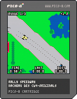

# Rally Speedway (PICO-8)

Ein Nachbau des C64-Klassikers **Rally Speedway** (John Anderson, Adventure
International, 1983/84) für die Fantasy-Konsole [PICO-8](https://www.lexaloffle.com/pico-8.php).

**[▶ Im Browser spielen](https://callimero.github.io/rally-speedway/)**

## Spiel

- Die 6 Original-Strecken, ringsum geschlossene Welt, Verengungen inklusive
- Gas gibt der Wagen von selbst – der Knopf **bremst** nur
- Lenken wie ein RC-Car: links/rechts relativ zur Fahrtrichtung, 32 Richtungen
- Rutschen, Bremsspuren, nasse und vereiste Straße, Aquaplaning (für Profis)
- Crash: Feuer, der Fahrer springt raus, brennt, wälzt sich und schimpft
- Computergegner **Blau** auf der Ideallinie, 3 Runden, Abstand in Sekunden

## Grafik

Alle Sprites (Auto, Fahrer, Randsteine) hat callimero neu gezeichnet. Die
C64-Pixel sind doppelt so breit wie hoch, die automatische Umrechnung auf
die quadratischen PICO-8-Pixel verlor zu viele Details.

## Unterschiede zum Original

**Weggelassen**

- **2 Spieler:** Das Original lässt zwei Spieler auf einem Bildschirm
  gegeneinander fahren. PICO-8 hat nur ein Steuerkreuz und zwei Knöpfe, und
  das Spiel soll auch auf PICO-8-Handhelds und unter Android laufen. Statt
  eines zweiten Spielers gibt es den Computergegner.
- **Strafregeln:** Im Original kosten ein Crash 10 Sekunden und das
  Zurückfallen um einen Bildschirm 5 Sekunden. Hier kostet ein Crash die Zeit
  der Fahrer-Animation.
- **Zweite Steuerungsart:** Das Original kann auch „Joystick-Richtung =
  Fahrtrichtung“. Hier wird nur relativ zur Fahrtrichtung gelenkt, wie bei
  einem RC-Car.
- **Streckeneditor:** Es gibt nur die 6 eingebauten Strecken, kein Speichern
  eigener Strecken.
- **Menüpunkt „Schaden“:** „nur im Computer“ (ohne Crash) fehlt, ein Crash
  zählt immer.
- **Höchsttempo:** Zur Wahl stehen 60–150 mph statt 40–200 mph.

**Neu oder anders**

- **Computergegner „Blau“:** Er fährt auf einer berechneten Ideallinie und
  passt sein Tempo an deines an (Gummiband), eher ein Trainingspartner als ein
  Gegner. Dazu kommen 3 Runden mit Ergebnis-Bildschirm und der Abstand in
  Sekunden oben rechts.
- **Streckenvorschau** im Menü, mit dem Kurs als Linie.
- **Effekte:**
  - Reifenspuren beim Rutschen und Bremsen
  - Rauch über brennendem Auto und Fahrer
  - Spritzwasser bei Nässe und beim Aquaplaning
  - Abprall mit Knall, wenn sich die Autos berühren
- **Fahrphysik:**
  - langsam durch Büsche fahren geht ohne Crash
  - Aquaplaning über kurze Wasserstücke
  - die Lenkung in 32 Stufen mit seitlichem Drift beim kurzen Tippen ist
    nachempfunden, nicht ausgelesen
- **Grafik**, an vielen Stellen bunter:
  - rot-weiße Randsteine statt roter Punkte
  - eigenes Feuer
  - Fahrer mit Overall, Helm und Schuhen, bei Gelb mit gelbem Overall
  - dunkelgrüne Pflanzen statt rot-rosa Büschen
  - die Straße wechselt die Farbe bei Nässe und Eis
- **Bildausschnitt:**
  - Die Kamera schaut in Fahrtrichtung voraus.
  - Durch 128 × 128 Pixel ist der Ausschnitt etwas schmaler und dafür höher
    als auf dem C64.
- **Technik:** Es läuft mit 60 statt 50 Bildern pro Sekunde. Farben und Töne
  sind an die PICO-8-Palette und ihre Klangerzeugung angepasst.
- **Bedienung:** ⬇️+🅾️ führt aus dem Rennen zurück ins Menü.

**Noch offen**

- **Fahrgefühl:** Tempo, Haftung und Lenkung sind nach Gefühl eingestellt.
  Für den Feinschliff fehlen direkte Vergleiche (A/B-Tests) mit dem
  C64-Original.

## Steuerung

| Taste | Funktion |
|---|---|
| ⬅️ ➡️ | lenken |
| 🅾️ / ❎ | bremsen |
| beliebige Richtung | Start |
| ⬇️ + 🅾️ | zurück ins Menü |

Im Browser: Pfeiltasten, **Z**/**X** (oder **C**/**V**) als Knöpfe; Gamepads
werden erkannt.

## Dateien

| Datei | Inhalt |
|---|---|
| `index.html`, `index.js` | Web-Player (GitHub Pages) |
| `rally.p8` | die Cart (in PICO-8: `load rally`) |
| `rally.p8.png` | dieselbe Cart als Bild-Datei |
| `rally.lua` | der Quellcode zum Lesen |
| `STRUKTUR.md` | Aufbau des Programms (Tabs, Ablauf, Physik, Welt, Speicher) |
| `REVISIONEN.md` | Entstehung und Begründungen, Version für Version |

Die Streckendaten (Raster und Ideallinie) liegen als Bitstrom im
Sound-Speicher (SFX 8–63) der Cart, nicht im Quellcode.

## Hinweis

Fan-Projekt ohne kommerzielle Absichten. Strecken, Zeichensatz und Figuren
sind dem C64-Original nachempfunden bzw. daraus übernommen; die Rechte daran
liegen bei den ursprünglichen Rechteinhabern.
